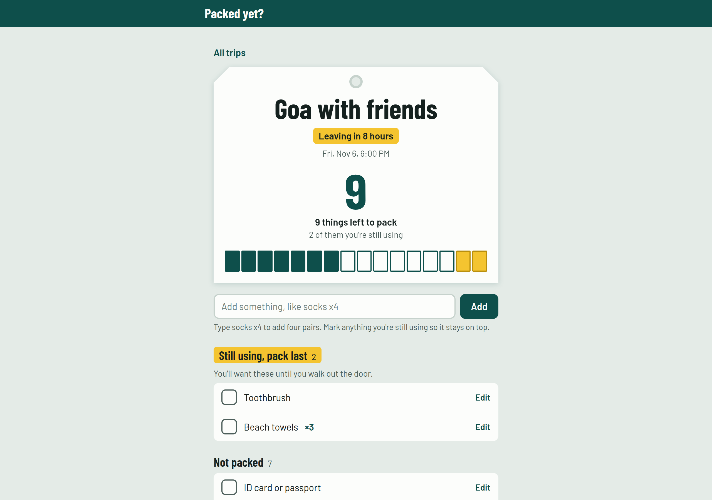

# Packed yet?

An offline packing list that reuses your last trip's list and shows what is still not in the bag before you leave.

Built in answer to a request on r/SomebodyMakeThis and r/AppIdeas (1–2 Nov 2026): *"an offline packing app that reminds you about the things you haven't packed … reuse a previous trip's packing list, change the quantities … things I'm still using before leaving are especially easy to miss."*



## What it does

- **Reuse a past trip.** A new trip starts from a copy of your last one by default, with every item unpacked again. Quantities and "still using" marks carry over.
- **Still using, pack last.** Mark the charger, toothbrush or anything you'll use until you walk out the door. Those stay in a yellow section at the top and are called out in the count.
- **See what's left at a glance.** The trip header is a luggage tag with a big "left to pack" number and one bar per item: solid when packed, hollow when not, yellow when still in use.
- **Check before leaving.** One screen with only the unpacked items, so you can tick off the last few things.
- **Calendar reminder.** Set a leave time and download a `.ics` event with alarms a day before and two hours before. The event lists what was unpacked when you made it.
- **Quantities while typing.** `socks x4` or `4x socks` adds four.
- **Offline, no account, no tracking.** Everything is stored in your browser. It installs as an app on a phone, and a backup file moves your lists to another device.

## Use it

Live: https://lnr-7.github.io/packed-yet/

On a phone, open the link, then use your browser's "Add to Home screen" to install it. It keeps working with no connection.

## Run it yourself

It is plain HTML, CSS and JavaScript with no build step.

```sh
git clone https://github.com/lnr-7/packed-yet.git
cd packed-yet
python3 -m http.server 8080
# open http://localhost:8080
```

Tests cover the data logic (quick-add parsing, reuse, countdowns, the calendar file, backups):

```sh
node --test
```

## How it is put together

| File | Role |
|---|---|
| `index.html` | Page shell and the three dialogs (trip form, leaving check, confirm) |
| `app.js` | Screens, saving to `localStorage`, hash routing |
| `logic.js` | Pure functions with no DOM access, so they can be tested with Node |
| `styles.css` | The luggage-tag look; Barlow and Barlow Condensed are bundled in `fonts/` |
| `sw.js` | Service worker that caches the app for offline use |
| `tests/` | `node --test` suite for `logic.js` |

Data lives under one `localStorage` key, `packed-yet:v1`, as `{ trips: [...] }`. A backup file is the same JSON.

## Limits

- Reminders are calendar events you download, not push notifications. A static site has no server to send them, and browsers do not run timed notifications for a closed page.
- Lists are per browser. Use "Save a backup file" and "Restore from a backup" to move them.

## License

MIT for the code (see `LICENSE`). The Barlow fonts are by Jeremy Tribby under the SIL Open Font License 1.1.
